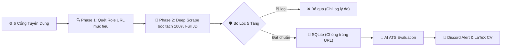

# 🎯 FindMyBoss

<div align="center">


**Hệ sinh thái tự động thu thập việc làm IT Việt Nam đa cổng, lọc thông minh theo nhu cầu, đối soát khoảng cách kỹ năng (ATS Match Score) và tự động biên dịch CV LaTeX cá nhân hóa theo từng tin tuyển dụng.**

[Cơ Chế Lọc Dữ Liệu](#-cơ-chế-cào--bộ-lọc-dữ-liệu-filtering-pipeline) • [Cấu Hình Theo Nhu Cầu](#-hướng-dẫn-cấu-hình-phù-hợp-nhu-cầu-người-dùng) • [Cài Đặt & Khởi Chạy](#-hướng-dẫn-cài-đặt--khởi-chạy-quickstart) • [Tự Động Hóa CLI](#-lệnh-chạy-cli--tự-động-hóa)

</div>

---

## ⚡ Tính Năng Cốt Lõi

1. **🕷️ Thu thập đa nền tảng (6 cổng)**: ITviec, TopDev, VietnamWorks, Indeed VN, TopCV, JobsGO.
2. **🛡️ Bộ lọc thông minh 5 tầng**: Lọc Role, Cấp bậc (Intern/Fresher/Junior/Senior), Địa điểm, Thời gian (24h qua) và Từ khóa cấm (Blacklist).
3. **🎯 Multi-Provider AI ATS**: Đánh giá độ phù hợp (Match Score %) và gợi ý từ khóa ATS bằng Google Gemini (hỗ trợ key miễn phí), OpenAI GPT-4o, Claude 3.5/3.7 hoặc DeepSeek/Local LLM.
4. **📄 Overleaf-Style Studio & Tectonic Engine**: Soạn thảo LaTeX trực tiếp với preview PDF thời gian thực, biên dịch nội bộ siêu tốc không cần cài đặt TeX Live cồng kềnh.
5. **🔔 Thông báo Discord tinh gọn**: Embed card chuẩn 3 cột ngang (`💰 Mức lương` | `🎯 Level` | `🎯 ATS Score`), tự động lấy Logo công ty/Avatar thương hiệu và gắn sẵn reaction `✅` / `❌`.

---

## 🔍 Cơ Chế Cào & Bộ Lọc Dữ Liệu (Filtering Pipeline)

> [!IMPORTANT]
> **FindMyBoss KHÔNG cào tràn lan toàn bộ internet**. Hệ thống vận hành theo quy trình **Two-Phase Harvester** kết hợp bộ lọc 5 tầng nghiêm ngặt:



### Chi tiết 5 tầng lọc:

| Tầng lọc | Cơ chế hoạt động | Mặc định | Tùy biến tại |
| :--- | :--- | :--- | :--- |
| **1. Role (Chuyên môn)** | Chỉ quét theo từ khóa & URL danh mục chuyên môn (`de`, `ai_ml`, `backend`, `frontend`, `fullstack`, `da`, `devops`, `mobile`, `tester`). Bỏ qua các ngành phi công nghệ. | Các role IT phổ biến | `data/scraper_config.json` hoặc Web Settings |
| **2. Level (Cấp bậc)** | Nhận diện cấp bậc tuyển dụng từ tiêu đề và kinh nghiệm yêu cầu. | `Intern`, `Fresher`, `Junior` | `levels` trong config |
| **3. Blacklist Cấp cao** | Tự động loại bỏ các tin tuyển dụng chứa: `senior`, `lead`, `manager`, `director`, `trưởng phòng`, `phó phòng`, `head`, `architect`... | Bật (Chặn Senior/Lead) | `blacklisted_keywords` trong config & `core/config.py` |
| **4. Location (Địa điểm)** | Chỉ lưu các tin tuyển dụng thuộc tỉnh thành mục tiêu hoặc chấp nhận Remote / Toàn quốc. | `Hồ Chí Minh`, `Remote`, `Toàn quốc` | `locations` trong config |
| **5. Timeframe (Thời gian)** | Cờ `--today`: Chỉ lấy tin đăng trong 24 giờ qua (`hôm nay`, `giờ trước`, `phút trước`). Bỏ cờ nếu muốn cào mọi tin mới nhất. | Bật (`today_only: true`) | Cờ CLI `--all` hoặc nút toggle trên Web |
| **6. Chống trùng lặp** | Kiểm tra `UNIQUE(link)` trên SQLite Database. Tin đã có trong cơ sở dữ liệu sẽ không bao giờ cào lại hoặc spam Discord. | Tự động | `services/storage.py` |

---

## 🛠️ Hướng Dẫn Cấu Hình Phù Hợp Nhu Cầu Người Dùng

Bạn có thể chỉnh sửa trực tiếp tại file `data/scraper_config.json` hoặc thao tác trực quan trên giao diện **Web Studio (Settings Modal)**:

### 🎯 Trường hợp 1: Bạn là Sinh viên / Fresher / Junior
* **Mục tiêu**: Tìm việc khởi đầu, tránh bị ngợp bởi các bài đăng Senior/Lead.
* **Thiết lập khuyến nghị trong `data/scraper_config.json`**:
```json
{
  "levels": ["Intern", "Fresher", "Junior"],
  "blacklisted_keywords": ["senior", "lead", "manager", "director", "trưởng phòng", "architect"],
  "today_only": true
}
```

### 💼 Trường hợp 2: Bạn là Middle / Senior Developer
* **Mục tiêu**: Tìm các vị trí chuyên sâu, lương cao, không lấy việc thực tập.
* **Thiết lập khuyến nghị**:
```json
{
  "levels": ["Middle", "Senior"],
  "blacklisted_keywords": ["intern", "thực tập", "trainee", "học việc", "fresher"],
  "today_only": true
}
```
*(Nếu muốn nhận vị trí Senior/Lead, hãy xóa `senior`, `lead` khỏi mảng `blacklisted_keywords` và `unwanted_titles`)*.

### 🌐 Trường hợp 3: Tùy biến Chuyên môn (Roles) & Địa điểm
* Chọn các role muốn cào trong mảng `"roles"`:
  * Backend: `"backend"`
  * Data Engineer: `"de"`
  * Data Analyst: `"da"`
  * AI / Machine Learning: `"ai_ml"`
  * DevOps / Cloud: `"devops"`
  * Frontend: `"frontend"`
  * Fullstack: `"fullstack"`
  * Mobile: `"mobile"`
  * Tester / QA: `"tester"`
* Chọn địa điểm trong mảng `"locations"`: `["Hà Nội", "Hồ Chí Minh", "Đà Nẵng", "Remote", "Toàn quốc"]`.

### 🔔 Trường hợp 4: Cấu hình Discord Alerts chuẩn đẹp
Thêm vào file `.env`:
```env
DISCORD_WEBHOOK_URL=https://discord.com/api/webhooks/YOUR_WEBHOOK_URL
DISCORD_BOT_TOKEN=YOUR_BOT_TOKEN   # (Tùy chọn: dùng để tự động gắn reaction ✅ / ❌)
```
Tin nhắn trên Discord sẽ hiển thị:
* **Tiêu đề**: Link xanh dẫn thẳng tới bài tuyển dụng gốc.
* **Mô tả**: `🏛️ Tên công ty · 📍 Địa điểm` và `🔗 [Xem chi tiết]`.
* **3 Cột thông tin**: `💰 Mức lương` | `🎯 Level` | `🎯 ATS Score` (🟢 Tốt ≥80%, 🟡 Có thể 60-79%, 🔴 Không hợp <60%).
* **Logo góc phải**: Ảnh/Logo công ty hoặc Avatar thương hiệu sắc nét.
* **Reactions**: Gắn sẵn `✅` và `❌` để người dùng tương tác ngay.

### 🧠 Trường hợp 5: Tùy biến AI & Master CV của bạn
1. **Lấy API Key**: Khuyên dùng **Google Gemini API** (hoàn toàn miễn phí, hạn mức cao tại [aistudio.google.com](https://aistudio.google.com)). Thêm vào `.env`:
   ```env
   GEMINI_API_KEY=AIzaSy...
   ```
   *(Ngoài ra hỗ trợ cả `OPENAI_API_KEY`, `ANTHROPIC_API_KEY`, `CUSTOM_AI_API_KEY` cho DeepSeek/Ollama)*.
2. **Cập nhật Profile kinh nghiệm thật**:
   * Truy cập Web Studio ➔ Tab **Profile** ➔ Tải lên file `master_cv.pdf` của bạn hoặc chỉnh sửa `data/profile.json`.
   * Hệ thống cam kết **dùng 100% kinh nghiệm thật của bạn làm Source of Truth**, không bịa đặt kinh nghiệm khi tối ưu CV.

---

## 🚀 Hướng Dẫn Cài Đặt & Khởi Chạy (Quickstart)

### Cách 1: Chạy trực tiếp với Python (Khuyên dùng cho cá nhân)

```bash
# 1. Clone repository
git clone https://github.com/alloc110/FindMyBoss.git
cd FindMyBoss

# 2. Tạo môi trường ảo & kích hoạt
python -m venv venv
# Windows:
.\venv\Scripts\activate
# Linux/macOS:
source venv/bin/activate

# 3. Cài đặt thư viện & trình duyệt Playwright
pip install -r requirements.txt
playwright install chromium

# 4. Tạo file cấu hình môi trường
copy .env.example .env

# 5. Khởi động Web Studio
python -m uvicorn web.app:app --host 0.0.0.0 --port 8080 --reload
```
👉 Mở trình duyệt truy cập: **[http://localhost:8080](http://localhost:8080)**

### Cách 2: Chạy với Docker Compose (Cụm 3 Microservices)

```bash
cp .env.example .env
make up
# Web Studio: http://localhost:8080
# Renderer:   http://localhost:8001
# Scraper:    http://localhost:8003
```

---

## 💻 Lệnh Chạy CLI & Tự Động Hóa

Bạn có thể cào việc trực tiếp từ Terminal mà không cần mở giao diện Web:

```bash
# Cào tin đăng hôm nay của tất cả các cổng
python -m crawl.orchestrator --today

# Cào tất cả tin mới nhất của ITviec và TopDev cho role Data Engineer
python -m crawl.orchestrator --all -p itviec,topdev -r de

# Lấy hướng dẫn các cờ lệnh
python -m crawl.orchestrator --help
```

### Lên lịch cào tự động hàng ngày lúc 22:00 (Windows Task Scheduler):
```powershell
# Chạy PowerShell bằng quyền Administrator:
.\scripts\schedule-task.ps1 -Register -DailyTime "22:00" -TodayOnly
```

---

## 🧪 Kiểm Thử Hệ Thống (Testing)

Hệ thống đi kèm bộ kiểm thử tự động toàn diện **38/38 Unit Tests** bao phủ trọn vẹn: logic bộ lọc, trình bóc tách logo, sinh mã LaTeX, engine Tectonic, SQLite storage và định dạng Discord embed:

```bash
python -m unittest discover -s tests -p "test_*.py"
```
Kết quả:
```text
Ran 38 tests in 10.3s
OK
```

---

## 📄 Bản Quyền & Giấy Phép
Dự án được phân phối theo giấy phép mã nguồn mở **MIT License**. Mọi đóng góp cải tiến đều được hoan nghênh! 🎯
