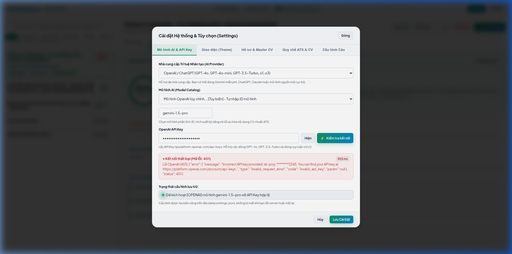
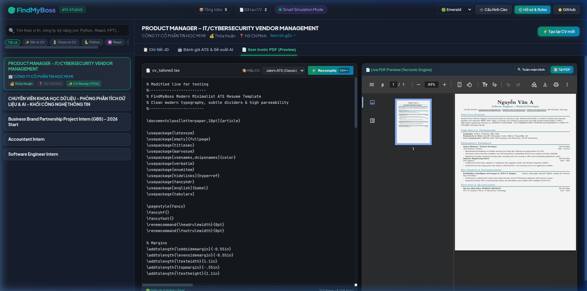
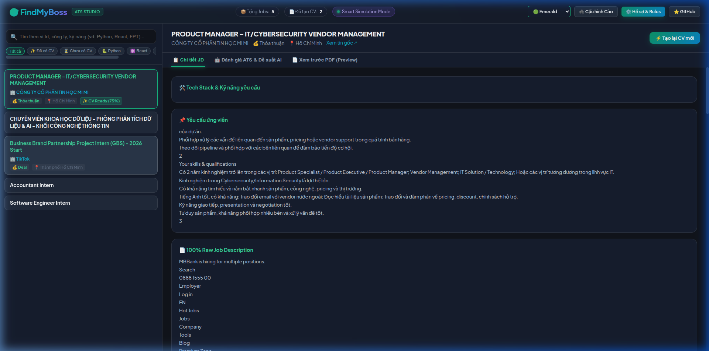
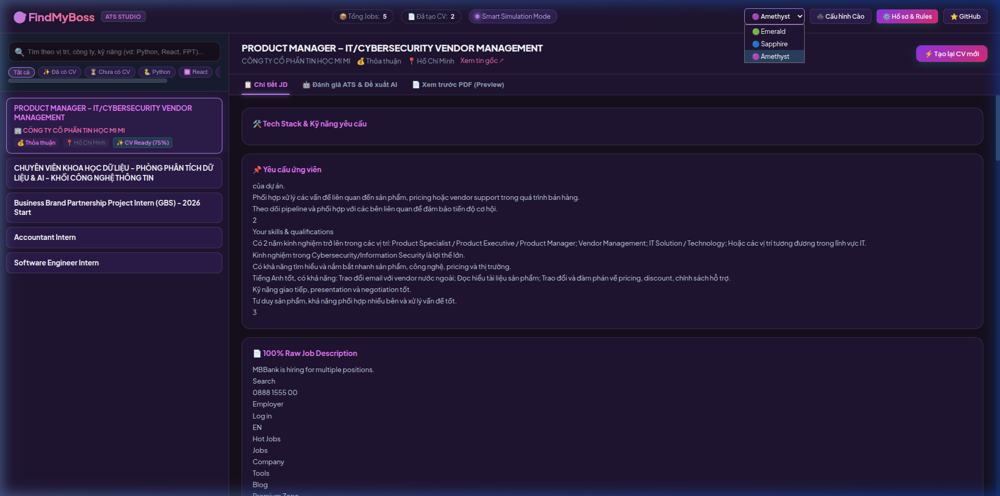
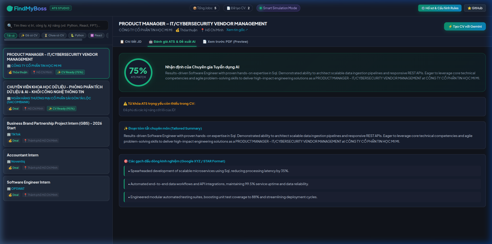
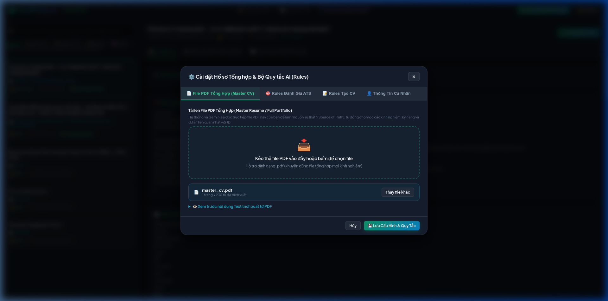
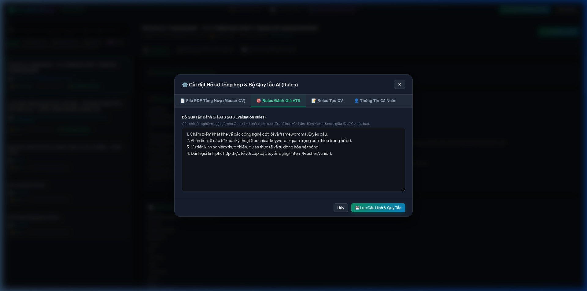
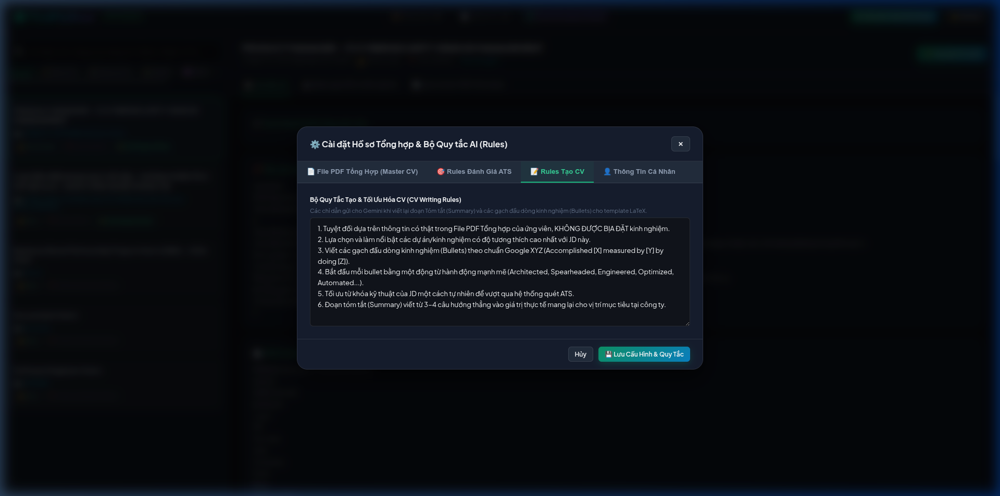
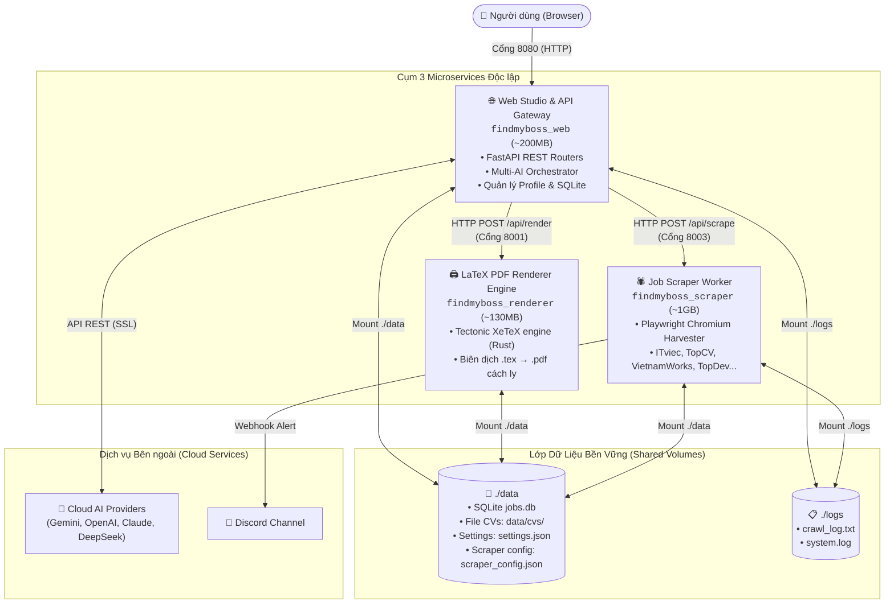
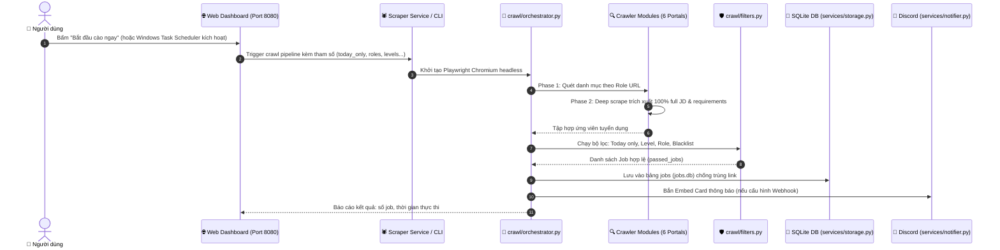

# 🎯 FindMyBoss

<div align="center">


**Hệ sinh thái tự động hóa thu thập việc làm IT Việt Nam đa nền tảng, phân tích khoảng cách ATS bằng Multi-Provider AI (Google Gemini, OpenAI ChatGPT, Anthropic Claude, DeepSeek/Local LLM), theo dõi tiến độ ứng tuyển và Overleaf-Style Studio tối ưu CV LaTeX tự động với Tectonic.**

[Demo Giao Diện](#-visual-showcase--demo) • [Tính Năng Cốt Lõi](#-tính-năng-cốt-lõi-key-features) • [Kiến Trúc Hệ Thống](#️-kiến-trúc-hệ-thống--docker-microservices) • [Tự Động Hóa & CLI](#-tự-động-hóa-cào-việc--cli-orchestrator) • [Tài Liệu REST API](#-tài-liệu-rest-api) • [Hướng Dẫn Cài Đặt](#️-hướng-dẫn-khởi-chạy-quickstart) • [Kiểm Thử Tự Động](#-kiểm-thử-tự-động-automated-testing)

</div>

---

## 🎬 Visual Showcase & Demo

### Thư viện Ảnh Tính năng (Screenshots Gallery)

| Đa Nhà Cung Cấp AI & Kiểm Tra API Key Trực Tiếp | Overleaf-Style Side-by-Side LaTeX Studio |
| :---: | :---: |
|  |  |
| *Hỗ trợ Gemini, ChatGPT (GPT-4o, o3-mini), Claude, DeepSeek cùng nút test kết nối đo độ trễ ms* | *Code LaTeX trực tiếp 50% bên trái & Live PDF Preview 50% bên phải (Phím tắt `Ctrl + Enter`)* |

| Quản lý Trạng thái Ứng tuyển & Xóa Job | Giao diện Tinh gọn & Theme Tối / Sáng |
| :---: | :---: |
|  |  |
| *Theo dõi tiến độ: Chưa nộp, Đã nộp, Phỏng vấn, Offer, Bị từ chối & Xóa job an toàn* | *Giao diện hiện đại không icon, chuyển đổi tức thì giữa Chế độ Tối và Chế độ Sáng* |

| Đánh giá ATS & Đề xuất AI theo Rules | Tải lên Master CV PDF (Nguồn Sự Thật) |
| :---: | :---: |
|  |  |
| *Chấm điểm Match Score %, lọc từ khóa thiếu, nạp Master CV & Rules* | *Tự động bóc tách text từ file PDF tổng hợp của bạn* |

| Cấu hình Rules Đánh Giá ATS | Cấu hình Rules Viết & Tối Ưu CV |
| :---: | :---: |
|  |  |
| *Tùy biến tiêu chí chấm điểm và lọc kỹ năng cốt lõi* | *Quy tắc chuẩn Google XYZ / STAR, Action Verbs, chống bịa đặt* |

---

## 🌟 Tính Năng Cốt Lõi (Key Features)

### 1. Đa Nhà Cung Cấp AI & Kiểm Tra Kết Nối Trực Tiếp (Multi-Provider Catalog & Live Key Test)
* **Hỗ trợ 4 hệ sinh thái AI hàng đầu**:
  * **Google Gemini**: `gemini-3.8-flash` (Mới nhất 3.8), `gemini-3.0-pro` (Flagship), `gemini-2.5-flash` (Khuyên dùng), `gemini-2.5-pro`, `gemini-2.0-flash`, `gemini-1.5-pro`, `gemini-1.5-flash`.
  * **OpenAI / ChatGPT**: `gpt-4o` (Flagship đa phương thức), `gpt-4o-mini` (Tối ưu chi phí), `gpt-3.5-turbo`, `o1-mini` & `o3-mini` (Reasoning).
  * **Anthropic Claude**: `claude-3-7-sonnet-latest` (Hybrid Reasoning), `claude-3-5-sonnet` (Chuẩn mực viết CV ATS), `claude-3-5-haiku`, `claude-3-opus`.
  * **DeepSeek / OpenAI-Compatible (Ollama, vLLM, OpenRouter)**: `deepseek-chat`, `deepseek-reasoner`, `qwen-2.5-72b`, `llama-3.3-70b` với endpoint URL tùy biến (vd: `http://localhost:11434/v1`).
* **Nút "Kiểm tra kết nối" (⚡ Live Ping Test)**:
  * Kiểm tra API Key ngay trong modal Settings trước khi lưu.
  * Đo lường **độ trễ mạng thực tế (Latency ms)**, báo lỗi rõ ràng nếu sai khóa (`401`), hết quota (`429`) hoặc sai model (`404`).
* **Cơ chế Fallback thông minh**: Nếu chưa có API key hoặc mạng gián đoạn, hệ thống tự động kích hoạt **Intelligent Heuristic Tailoring** đối soát kỹ năng và tạo CV hoàn chỉnh mà không làm gãy ứng dụng.

### 2. Thu Thập Dữ Liệu 6 Cổng Tuyển Dụng & Lọc Đa Tầng (Crawler Pipeline)
* **Thu thập đồng thời 6 cổng thông tin**: **ITviec, TopDev, TopCV, VietnamWorks, JobsGO, Indeed VN**.
* **Quy trình cào 3 giai đoạn (Two-Phase Harvester)**:
  * **Phase 1 (Fast Discovery)**: Quét nhanh danh mục tìm kiếm theo vai trò chuyên môn (Role-based targeting).
  * **Phase 2 (Deep Scrape)**: Truy cập chi tiết từng tin để bóc tách 100% full JD, yêu cầu kỹ thuật, chế độ đãi ngộ và lương thực tế.
  * **Phase 3 (Multi-Filter & Clean)**: Lọc qua bộ lọc đa tầng thời gian thực trước khi lưu vào SQLite:
    * **Lọc thời gian đăng (Today Only)**: Tùy chọn chỉ lấy tin đăng trong 24 giờ qua (`hôm nay`, `giờ`, `phút`, `fromage=1`).
    * **Lọc cấp bậc (Experience Level)**: Nhận diện chính xác `Intern`, `Fresher`, `Junior`, `Middle`, `Senior`.
    * **Lọc chuyên môn (Role Specialization)**: Phân loại tự động `Backend`, `Frontend`, `Fullstack`, `Data Analyst (DA)`, `Data Engineer (DE)`, `AI / ML`, `Mobile`, `Tester (QA/QC)`, `DevOps`.
    * **Lọc địa điểm & Từ khóa loại trừ (Blacklist)**: Loại bỏ các tin tuyển dụng chứa từ khóa không mong muốn (*Lead, Manager, Trưởng phòng, Đào tạo, Tuyển sinh*).

### 3. Tự Động Hóa Lịch Chạy Hàng Ngày (Windows Task Scheduler & Batch Runner)
* **Lên lịch tự động 22:00 mỗi ngày**: Script PowerShell [scripts/schedule-task.ps1](scripts/schedule-task.ps1) đăng ký dịch vụ chạy ngầm với Task Scheduler.
* **CLI Runner linh hoạt**: [scripts/run-scraper.bat](scripts/run-scraper.bat) và [crawl/orchestrator.py](crawl/orchestrator.py) hỗ trợ cờ lệnh dòng lệnh (`--today`, `--all`, `-p`, `-r`, `-m`).

### 4. Overleaf-Style LaTeX CV Studio & Biên Dịch Tectonic Tốc Độ Cao
* **Dual-Pane IDE trực quan**: Chia đôi màn hình 50/50 chuẩn Overleaf. Cột trái chỉnh sửa mã nguồn LaTeX với số dòng, phím tắt `Ctrl + Enter` hoặc `Cmd + Enter` để Recompile tức thì.
* **Live PDF Preview**: Xem trước kết quả PDF sắc nét ngay bên phải màn hình thông qua engine biên dịch Tectonic XeTeX tốc độ cao (2.7s).
* **Mẫu CV ATS đa dạng**: Chuyển đổi nhanh giữa `Jake's Resume ATS (Classic)`, `Modern Professional`, và `Compact 1-Page`.

### 5. Quản Lý Tiến Độ Ứng Tuyển & Đồng Bộ Master CV
* **Vòng đời ứng tuyển toàn diện**: `Chưa nộp` (`saved`) ➔ `Đã nộp` (`applied`) ➔ `Phỏng vấn` (`interviewing`) ➔ `Offer` (`offered`) ➔ `Bị từ chối` (`rejected`).
* **Kéo & Thả Master CV PDF (Source of Truth)**: Tải lên file PDF tổng hợp kinh nghiệm, hệ thống dùng `pypdf` trích xuất văn bản gốc để AI chỉ sử dụng dữ liệu có thật, **nghiêm cấm bịa đặt kinh nghiệm**.
* **Lưu trữ chuẩn SQLite WAL Mode**: Đảm bảo tốc độ truy vấn cao, deduplication chống trùng lặp theo `UNIQUE(link)`.

---

## 🏗️ Kiến Trúc Hệ Thống & Docker Microservices

### 1. Sơ đồ Kiến trúc Microservices Stack



### 2. Luồng Xử Lý Cào Việc Làm & Lọc Đa Tầng



### 3. Phân Công Nhiệm Vụ Thư Mục (Code Mapping)

| Thư mục | Vai trò trong hệ thống | Các Service / Module cốt lõi |
| :--- | :--- | :--- |
| **[core/](core/)** | Cấu hình toàn cục, logging, timezone Việt Nam | `config.py` (ScraperConfig, get_logger, VN_TIMEZONE) |
| **[crawl/](crawl/)** | Động cơ thu thập dữ liệu & bot cào | `orchestrator.py`, `filters.py`, `ITviecJob.py`, `TopDevJob.py`, `TopCVJob.py`, `VietnamWorksJob.py`, `JobsGoJob.py`, `IndeedJob.py` |
| **[services/](services/)** | Bộ não xử lý nghiệp vụ trung tâm | `ai/` (Gemini, OpenAI, Claude, Custom), `storage.py` (SQLite), `latex_engine.py`, `profile_service.py`, `notifier.py` |
| **[web/](web/)** | Web Studio UI & API Gateway | `app.py` (FastAPI), `routers/` (`jobs`, `scraper`, `settings`, `profile`), `dependencies.py` |
| **[templates/](templates/)** | Mẫu CV mã nguồn LaTeX chuẩn ATS | `cv_template.tex` (Classic), `cv_template_modern.tex`, `cv_template_compact.tex` |
| **[scripts/](scripts/)** | Script điều hành & tự động hóa | `run-scraper.bat`, `schedule-task.ps1`, `run-docker.sh`, `run-scraper.sh` |
| **[docker/](docker/)** | Đóng gói 3 microservices chuyên biệt | `web/Dockerfile`, `renderer/Dockerfile`, `scraper/Dockerfile` |
| **[tests/](tests/)** | Bộ kiểm thử tự động toàn diện (27 test) | `test_models.py`, `test_notifier.py`, `test_sqlite_storage.py`, `test_latex_compiler.py`, `test_web_api.py`, `test_filters.py`, `test_storage_and_cv.py` |

---

## 🤖 Tự Động Hóa Cào Việc & CLI Orchestrator

FindMyBoss hỗ trợ cả chế độ cào tương tác qua Web UI lẫn cào tự động ngầm qua Command Line Interface (CLI) và Windows Task Scheduler:

### 1. Tham số Dòng Lệnh CLI (`crawl/orchestrator.py`)

Chạy trực tiếp từ terminal:
```bash
python -m crawl.orchestrator [OPTIONS]
```

| Tham số | Tên đầy đủ | Ý nghĩa | Ví dụ |
| :--- | :--- | :--- | :--- |
| `-t` | `--today` | Chỉ cào các tin đăng trong ngày hôm nay (24h) | `python -m crawl.orchestrator --today` |
| | `--all` | Cào mọi tin tuyển dụng mới nhất (bỏ qua `today_only`) | `python -m crawl.orchestrator --all` |
| `-p` | `--portals` | Danh sách cổng tuyển dụng (cách nhau bởi dấu phẩy) | `-p itviec,topcv,vietnamworks` |
| `-r` | `--roles` | Danh sách chuyên môn mục tiêu | `-r backend,da,de,ai_ml,devops` |
| `-m` | `--max-pages` | Số trang tối đa quét mỗi cổng | `-m 3` |
| `-h` | `--help` | Hiển thị bảng trợ giúp hướng dẫn | `python -m crawl.orchestrator --help` |

### 2. Tiện ích Batch Windows (`scripts/run-scraper.bat`)

Tự động tìm kiếm Python (venv ➔ miniconda ➔ system), thiết lập bảng mã UTF-8 (`chcp 65001`) và chuyển tiếp mọi tham số:
```cmd
:: Cào chỉ tin trong ngày hôm nay
.\scripts\run-scraper.bat --today

:: Cào tất cả tin mới nhất của ITViec và TopCV
.\scripts\run-scraper.bat --all -p itviec,topcv

:: Xem hướng dẫn
.\scripts\run-scraper.bat --help
```

### 3. Tự Động Hóa Lịch Chạy Hàng Ngày (`scripts/schedule-task.ps1`)

Đăng ký hoặc kiểm tra tác vụ tự động với Windows Task Scheduler:
```powershell
# 1. Đăng ký chạy hàng ngày vào 22:00 (đọc thiết lập từ scraper_config.json)
.\scripts\schedule-task.ps1 -Register -DailyTime "22:00"

# 2. Đăng ký chạy hàng ngày và BẮT BUỘC chỉ cào tin hôm nay (--today)
.\scripts\schedule-task.ps1 -Register -DailyTime "22:00" -TodayOnly

# 3. Kiểm tra trạng thái tác vụ
.\scripts\schedule-task.ps1 -Status

# 4. Kích hoạt chạy thử ngay lập tức trong nền
.\scripts\schedule-task.ps1 -RunNow

# 5. Hủy đăng ký tác vụ
.\scripts\schedule-task.ps1 -Unregister
```

---

## 📡 Tài Liệu REST API

FastAPI tự động cung cấp Swagger UI tương tác tại: **`http://localhost:8080/docs`**

### Nhóm 1: Quản lý Công việc (`/api/jobs`)
| Method | Endpoint | Mô tả |
| :--- | :--- | :--- |
| `GET` | `/api/jobs` | Lấy danh sách việc làm (hỗ trợ lọc theo `status`, `portal`, `search`) |
| `GET` | `/api/jobs/{job_id}` | Xem chi tiết 1 tin tuyển dụng |
| `PATCH` | `/api/jobs/{job_id}/status` | Cập nhật trạng thái ứng tuyển (`saved`, `applied`, `interviewing`, `offered`, `rejected`) |
| `DELETE` | `/api/jobs/{job_id}` | Xóa việc làm và dọn dẹp các CV PDF liên quan |
| `POST` | `/api/jobs/{job_id}/tailor-cv` | Yêu cầu AI phân tích ATS và viết CV LaTeX theo template |

### Nhóm 2: Điều khiển Bộ Cào (`/api/scraper`)
| Method | Endpoint | Mô tả |
| :--- | :--- | :--- |
| `GET` | `/api/scraper/config` | Lấy cấu hình cào việc động (portals, roles, levels, today_only, blacklist...) |
| `PUT` | `/api/scraper/config` | Cập nhật cấu hình cào việc động lưu vào `data/scraper_config.json` |
| `POST` | `/api/scraper/run` | Kích hoạt worker cào việc làm (Microservice hoặc local background task) |
| `GET` | `/api/scraper/status` | Kiểm tra tiến độ cào hiện tại (cổng đang cào, số lượng job thu thập) |

### Nhóm 3: Cấu hình Hệ thống & AI (`/api/settings`)
| Method | Endpoint | Mô tả |
| :--- | :--- | :--- |
| `GET` | `/api/settings` | Lấy toàn bộ cài đặt (AI provider, model, theme, API keys ẩn) |
| `PUT` | `/api/settings` | Lưu cấu hình hệ thống vào `data/settings.json` |
| `POST` | `/api/settings/test-connection` | Kiểm tra kết nối API Key và đo độ trễ mạng thực tế (Latency in ms) |
| `GET` | `/api/settings/models` | Lấy danh mục các model AI được hỗ trợ theo từng nhà cung cấp |

### Nhóm 4: Ứng viên & Master CV (`/api/profile`)
| Method | Endpoint | Mô tả |
| :--- | :--- | :--- |
| `GET` | `/api/profile` | Lấy thông tin ứng viên, bộ rules ATS và nội dung Master CV |
| `PUT` | `/api/profile` | Cập nhật profile ứng viên và rules viết CV |
| `POST` | `/api/profile/upload-pdf` | Tải lên Master CV PDF, tự động bóc tách text bằng `pypdf` |

---

## 🕹️ Hướng Dẫn Khởi Chạy (Quickstart)

### Lựa chọn 1: 🐳 Docker Microservices (Production Ready)

```bash
# 1. Clone repository
git clone https://github.com/alloc110/FindMyBoss.git
cd FindMyBoss

# 2. Tạo file môi trường từ mẫu
cp .env.example .env

# 3. Khởi chạy toàn bộ 3 microservices bằng 1 lệnh:
make up
# Hoặc: ./scripts/run-docker.sh up
```

Cụm microservices sẽ khởi tạo:
* **Web Studio**: [http://localhost:8080](http://localhost:8080)
* **LaTeX Renderer API**: [http://localhost:8001/health](http://localhost:8001/health)
* **Job Scraper Worker API**: [http://localhost:8003/health](http://localhost:8003/health)

```bash
# Quản lý containers:
make status          # Xem trạng thái & health check của cụm 3 services
make logs s=web      # Xem log service Web Studio
make logs s=scraper  # Xem log service Scraper Worker
make down            # Dừng hệ thống (dữ liệu SQLite trong ./data được bảo toàn)
```

### Lựa chọn 2: Local Development (Không cần Docker)

```bash
# 1. Tạo và kích hoạt virtual environment
python -m venv venv

# Windows:
.\venv\Scripts\activate
# Linux/macOS:
source venv/bin/activate

# 2. Cài đặt thư viện & Playwright Chromium
pip install -r requirements.txt
playwright install chromium

# 3. Khởi động Web Studio
python -m uvicorn web.app:app --host 0.0.0.0 --port 8000 --reload
```
Truy cập giao diện tại: **[http://localhost:8000](http://localhost:8000)**.

---

## ⚙️ Biến Môi Trường (Environment Variables)

Hệ thống hỗ trợ cấu hình qua file `.env` hoặc trực tiếp từ **Settings Modal** trên Web UI (lưu tại `data/settings.json`):

| Biến môi trường | Bắt buộc | Mô tả |
| :--- | :---: | :--- |
| `GEMINI_API_KEY` | Không | Google Gemini API Key — lấy miễn phí tại [aistudio.google.com](https://aistudio.google.com) |
| `OPENAI_API_KEY` | Không | OpenAI API Key — lấy tại [platform.openai.com](https://platform.openai.com/api-keys) |
| `ANTHROPIC_API_KEY` | Không | Anthropic Claude API Key — lấy tại [console.anthropic.com](https://console.anthropic.com) |
| `CUSTOM_AI_API_KEY` | Không | Khóa API cho DeepSeek, Ollama, OpenRouter |
| `DISCORD_WEBHOOK_URL` | Không | Discord Webhook URL để nhận thông báo công việc mới |
| `SCRAPER_PORT` | Không | Cổng dịch vụ Scraper Microservice (mặc định: `8003`) |

---

## 🧪 Kiểm Thử Tự Động (Automated Testing)

Toàn bộ **27/27 Unit Tests** kiểm thử toàn diện mọi tầng nghiệp vụ:

```bash
python -m unittest discover tests/ -v
```

```text
test_filter_jobs_by_web_config (test_filters.TestFilters) ... ok
test_is_location_matched (test_filters.TestFilters) ... ok
test_is_title_blacklisted (test_filters.TestFilters) ... ok
test_escape_latex (test_latex_compiler.TestLatexCompilerAndAI) ... ok
test_gemini_service_heuristic_fallback (test_latex_compiler.TestLatexCompilerAndAI) ... ok
test_latex_engine_code_generation (test_latex_compiler.TestLatexCompilerAndAI) ... ok
test_clean_bullet_points (test_models.TestJobModelAndScraper) ... ok
test_filter_unwanted_titles (test_models.TestJobModelAndScraper) ... ok
test_job_discord_embed_fallback (test_models.TestJobModelAndScraper) ... ok
test_job_discord_embed_rich_structure (test_models.TestJobModelAndScraper) ... ok
test_notifier_disabled_when_empty_webhook (test_notifier.TestDiscordNotifier) ... ok
test_notifier_send_success (test_notifier.TestDiscordNotifier) ... ok
test_job_status_and_deletion (test_sqlite_storage.TestSQLiteStorage) ... ok
test_save_and_retrieve_jobs (test_sqlite_storage.TestSQLiteStorage) ... ok
test_tailored_cv_workflow (test_sqlite_storage.TestSQLiteStorage) ... ok
test_cv_tailor_prompt_builder (test_storage_and_cv.TestStorageAndCVTailor) ... ok
test_save_and_deduplicate_jobs (test_storage_and_cv.TestStorageAndCVTailor) ... ok
test_get_profile_and_update (test_web_api.TestWebAPI) ... ok
test_job_status_and_delete_endpoints (test_web_api.TestWebAPI) ... ok
test_list_jobs_endpoint (test_web_api.TestWebAPI) ... ok
test_model_catalog_and_connection (test_web_api.TestWebAPI) ... ok
test_scraper_config_endpoints (test_web_api.TestWebAPI) ... ok
test_serve_html_dashboard (test_web_api.TestWebAPI) ... ok
test_settings_endpoints (test_web_api.TestWebAPI) ... ok
test_stats_endpoint (test_web_api.TestWebAPI) ... ok
test_tailor_cv_with_template_option (test_web_api.TestWebAPI) ... ok
test_upload_master_cv_pdf (test_web_api.TestWebAPI) ... ok
----------------------------------------------------------------------
Ran 27 tests in 2.6s

OK
```

---

## 📄 License

Dự án phát hành theo giấy phép **MIT License**. Mọi đóng góp (Pull Request, Issue) đều được chào đón! 🎯
